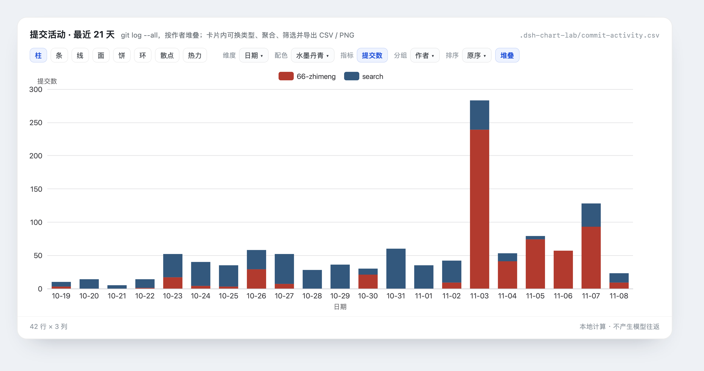

<p align="center"></p>

# dsh-chart-lab

Interactive ECharts cards for [DeepSeek Harness](https://github.com/deepseek-ai/deepseek-harness) (`dsh`).

**In one line:** the host loads your dataset from the workspace, the browser card does all the slicing — and clicking a button costs zero tokens and zero model turns.

English | [中文](README.zh-CN.md)

## Why

Generative-UI plugins usually route every interaction back through the model: one click = one full model call, a regenerated card, and a growing history. That is fine for a form, and ruinous for a chart you want to *explore*.

`chart_lab` splits the two audiences apart:

| | model sees | card sees |
| --- | --- | --- |
| after `execute()` | a one-line summary (~220 bytes) | the full dataset |
| per interaction | nothing | a local recompute (~5 ms for 50k rows) |

So a 50,000-row file costs the model a dozen tokens, and switching chart type, changing the dimension, filtering, or re-aggregating never reaches the model at all.

## How it works

```
model  ──chart_lab({file, recipe, chart})──▶  host (node)
                                               │  execute(): read file, parse, infer column types
                                               │
       ◀── render(): one-line summary ─────────┤
                                               │
       presentationMeta(args, value) ──────────┴──▶  full dataset + recipe source
                                                             │
                                                             ▼
                                          browser: keyed `tool.call.toolview`
                                          (everything from here is local)
```

The hinge is the **second argument** to `output.presentationMeta(args, value)`: it receives `execute()`'s return value, so the host can hand the browser a payload the model never sees. `output.render` narrows the same result to the single line that enters the prompt.

## Install

```sh
dsh plugin --profile web add github:66-zhimeng/dsh-chart-lab
```

(Not on npm yet; once it is published, `dsh plugin --profile web add dsh-chart-lab` will work too.)

Then make sure `dsh-chart-lab` appears in `dsh.profile.bundles` in `$DSH_HOME/profiles/web/package.json` (`dsh plugin add` normally reconciles this for you) and restart `dsh web`.

To hack on it locally, clone the repository and link it instead:

```sh
git clone https://github.com/66-zhimeng/dsh-chart-lab
cd dsh-chart-lab && npm install
dsh plugin --profile web add link:$PWD
```

Requires Node ≥ 22. ECharts is a normal dependency, fetched by your package manager and served lazily by the plugin's own route — it is not bundled into the client payload.

## Tool arguments

| argument | meaning |
| --- | --- |
| `file` | dataset path inside the workspace: `.json` / `.ndjson` / `.jsonl` / `.csv` / `.tsv`. **Preferred** — never enters the model's context |
| `pick` | dotted path into a JSON document, e.g. `"result.series"` |
| `rows` | inline rows; only for a few dozen rows |
| `url` | JSON endpoint fetched host-side |
| `recipe` | path to a workspace JS file adding custom controls and transforms |
| `chart` | initial view: `{type, x, y[], agg, group, topN, sort, stack, xName, yName, unit}` |
| `title` / `note` | card heading and subtitle |

Paths may not escape the workspace root (the directory `dsh` was started in).

Accepted document shapes: a plain array, a `{rows|data|items|records|list|result: [...]}` wrapper, a column-oriented `{a: [...], b: [...]}` table, or a single record.

## What the card can do — all locally

Chart type (bar / horizontal bar / line / area / pie / donut / scatter / heatmap / table) · dimension · multi-metric selection · aggregation (sum / avg / count / median / min / max / raw) · split-by column · category filter chips · sort · Top-N · stacking · smoothing · drag-to-resize · CSV and PNG export · reset.

ECharts contributes legend toggling, tooltips with a crosshair, and wheel/drag zoom with a slider once a view exceeds 24 categories.

Axis captions are derived from the selected columns, so they follow the dropdowns without model involvement. A unit written into the column name — `Output(t)`, `能耗(kWh)`, `latency[ms]` — is detected automatically and appended to the axis and the tooltip; `chart.unit` overrides it.

Card state is keyed by tool call id, so scrolling away and back does not reset it.

## Artifact cards (kept out of folded work details)

A chart is an **output**, not process. A tool result may declare itself one:

```js
// lib/tool.js
return { ...payload, artifact: true }
```

The chat layer then keeps that node outside the completed Turn's folded work
details and outside collapsed step groups.

That behaviour needs a local patch to the installed dsh bundle until the
contract exists upstream:

```sh
node patches/artifact-results.mjs           # apply
node patches/artifact-results.mjs --check   # status
node patches/artifact-results.mjs --revert  # restore
```

The first apply backs the original bundle up as `client.js.orig`; re-run it
after upgrading dsh, then refresh the page.

## Control bar policy

Controls that cannot change the current picture are not rendered: no stacking
for a single series, no Top-N below nine categories, no aggregation when the
dimension is unique, no sorting below three categories, smoothing only for
line/area. A button that does nothing is worse than a missing one.

The colour picker offers six schemes (default, ink, Dunhuang, celadon, Morandi,
vivid); switching redraws locally without another model turn.

## Recipes: project-local processing code

A recipe is a JS file in your own repository (`.dshviz/recipes/*.js` by convention). It is a **function body** that returns an object:

```js
return {
  controls: [
    { id: 'win',    kind: 'select', label: 'Window', options: [['3', '3d'], ['7', '7d']], value: '3' },
    { id: 'showVal', kind: 'toggle', label: 'Labels', value: false },
    { id: 'floor',  kind: 'slider', label: 'Floor', min: 0, max: 100, step: 5, value: 0 },
    { id: 'redo',   kind: 'button', label: 'Recompute' },   // value is a counter
  ],
  transform({ rows, controls, state, columns, h }) { return rows },      // optional
  option({ option, rows, view, controls, state, h }) { return option },  // optional
}
```

- `controls` — this recipe's control values. **Prefer this** over `state`.
- `state` — built-in view state, with `controls` merged over it.
- `h` — `sum / avg / median / min / max / num / label / uniq / groupBy / parseDate / fmt`.
- Both functions run in the browser; moving a control re-runs only them.
- A throw is contained: `transform` falls back to the untransformed rows with a warning on the card, `option` falls back to the built-in configuration.

**Reserved control ids** — `type`, `x`, `y`, `agg`, `group`, `topN`, `sort`, `stack`, `smooth`, `filters`, `view`, `height`. These name built-in controls; reusing one shadows it in `state` and makes the corresponding built-in button appear dead. The card warns when it happens. Chart type, smoothing, stacking, filtering, Top-N, sorting, and aggregation already have built-in buttons — a recipe should only add what they do not cover.

Runnable examples live in [`examples/`](examples/).

## Development

No build step: `lib/*.js` is what runs. The node half is ESM; the client half is hand-written CJS inside the `__ModuleLoader__.load` wrapper, so it can be patched in place like any other installed dsh plugin.

```sh
npm install
npm test        # 42 data-engine assertions + 16 jsdom interaction assertions
```

`scripts/test-client.mjs` covers the aggregation pipeline, recipe evaluation, and option building. `scripts/test-interaction.mjs` mounts the real card in jsdom, clicks the controls, and asserts the chart is actually redrawn — the suite that catches "the button highlights but nothing happens".

## Limits

- 200,000 rows per card; beyond that the payload is evenly sampled and the card says so.
- The dataset is persisted with the session log as the result node's `meta`, so a page reload keeps the card working — but very large datasets make the log large.
- Recipes are trusted project code evaluated with `new Function`. There is no sandbox.
- No SQL source: export to a file first, or point `url` at an endpoint you already have.

## License

MIT. ECharts is a dependency under Apache-2.0 and is not redistributed by this repository.

<p align="center"></p>
